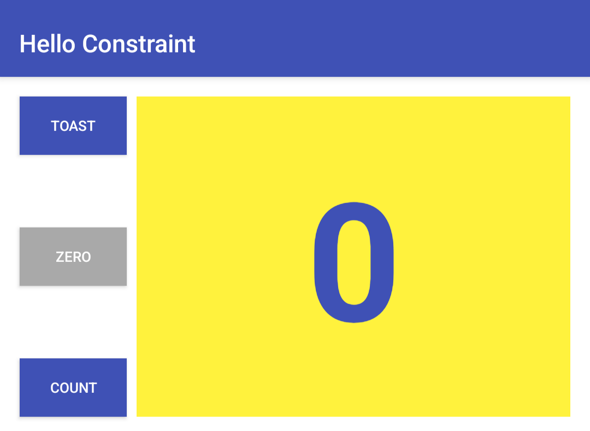
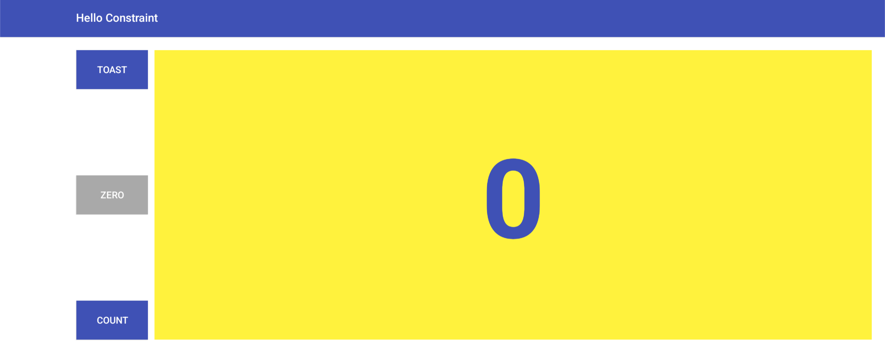

# HelloConstraint

Preprosta Android aplikacija s števcem in tremi gumbi, izdelana v programskem jeziku **Java** z uporabo **XML**.

Projekt je bil razvit v okolju Android Studio kot del šolske naloge pri predmetu Razvoj mobilnih aplikacij.

## Funkcionalnosti

- Povečevanje vrednosti števca z gumbom **Count**.
- Ponastavitev števca na nič z gumbom **Zero**.
- Prikaz kratkega obvestila z gumbom **Toast**.
- Spreminjanje barv gumbov glede na vrednost in stanje števca.
- Prilagojena postavitev za pokončno in ležečo orientacijo zaslona.
- Razporeditev elementov z uporabo `ConstraintLayout`.

## Posnetki zaslona

### Pokončna postavitev

### Ležeča postavitev

## Uporabljene tehnologije

| Tehnologija | Namen |
|---|---|
| Java | Programska logika aplikacije |
| XML | Oblikovanje uporabniškega vmesnika |
| ConstraintLayout | Razporeditev elementov |
| Android Studio | Razvojno okolje |
| Gradle | Gradnja projekta |

## Delovanje aplikacije

Aplikacija vsebuje tri gumbe: **Toast**, **Zero** in **Count**.

Gumb Count povečuje vrednost števca in spreminja barvo glede na sodo ali liho vrednost. Gumb Zero ponastavi števec na 0 in vrne svojo barvo na sivo.

Gumb Toast prikaže kratko obvestilo na zaslonu.

Postavitev aplikacije je prilagojena različnim orientacijam zaslona.

## Zagon projekta

1. Prenesite ali klonirajte repozitorij.
2. Odprite projekt v Android Studiu.
3. Počakajte na sinhronizacijo Gradle.
4. Izberite emulator ali Android napravo.
5. Zaženite aplikacijo z gumbom **Run**.

## Namen projekta

Cilj projekta je spoznati delo z gumbi, števcem, obdelavo klikov in prilagajanjem uporabniškega vmesnika različnim velikostim zaslona.

Projekt je namenjen izobraževalnim namenom.
